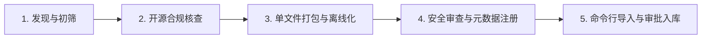

# OneHTML 内容挖掘渠道库与冷启动入库 SOP

本文档由 **OneHTML 内容策展专员（Content Curator）** 编制，用于建立 OneHTML 每日单文件 HTML5 作品的挖掘、审核、标准化打包与入库归档机制。

---

## 一、 核心挖掘渠道库与抓取线索

作为极客向、高审美、极致轻量化的单文件 HTML 平台，OneHTML 的内容基石是 **WebGL 3D、Shader 艺术、复古轻量游戏、创意生成式交互演示**。以下为每日日常巡检的核心渠道矩阵：

### 1. 竞赛与极致代码社区 (Extreme Constraints & Competitions)
| 渠道名称 | 监控入口 / 过滤方式 | 核心作品形态 | 策展价值与评估重点 |
| :--- | :--- | :--- | :--- |
| **js13kGames** | `js13kgames.com/entries` / GitHub `js13kGames/*` | 极致压缩在 13KB 以内的 WebGL/Canvas 游戏 | 顶级极客作品，自带高关注度与极小体积，几乎全原生零外部依赖。 |
| **JS1k 历史典藏** | `js1k.com` 历史归档 / GitHub `demoarchive` | 1KB 极端体积下的 3D 渲染、分形、波纹模拟 | 硬核数学与 Shader 奇迹，单文件纯原生嵌入的典范。 |
| **Dwitter (dwitter.net)** | 每日 Top / Top of All Time (140 字符 JS Canvas) | 极短代码驱动的惊艳生成式艺术 (Generative Art) | 适合轻量交互与视觉玩具分类，加载秒开，视觉冲击强烈。 |
| **Shadertoy** | `shadertoy.com/results?sort=popular` | 顶级纯 GLSL Fragment Shader 艺术 | 封装为单 HTML `<canvas>` + WebGL Shader 容器即成为殿堂级视觉展示。 |

### 2. 海外开发者与极客社区 (Developer & Indie Communities)
| 渠道名称 | 监控入口 / 过滤方式 | 核心作品形态 | 策展价值与评估重点 |
| :--- | :--- | :--- | :--- |
| **CodePen** | `codepen.io/trending` (筛选 `#threejs`, `#webgl`, `#canvas`, `#game`) | 交互式 3D 实验、微前端小玩具、CSS/Canvas 视觉 | 大量原创独立展示，单文件化改造门槛低，需严格核查作者声明。 |
| **GitHub Trending** | 关键词搜索: `topic:single-file-html`, `topic:html5-games`, `filename:index.html` | 开源独立完整 HTML5 作品、教学实验、AI 演示 | 开源协议最清晰 (LICENSE 文件)，作者 attribution 完备。 |
| **Hacker News (YCombinator)** | `news.ycombinator.com` (Show HN / Ask HN 搜索 "single file html", "game in one file") | 独立开发者个人扛鼎之作（如 Q1K3、TinyCraft、Slow Roads） | 开发者社区声量巨大，容易形成社交裂变传播。 |
| **itch.io** | `itch.io/games/platform-web/tag-browser` (按 Top Rated / Recent) | 复古像素、物理益智、短平快独立小游戏 | 游戏玩法深度高、耐玩度好；需核查是否含外部二进制打包资源。 |

### 3. 生成式 AI 交互与前沿探索社区 (AI-Generated & Artifacts)
| 渠道名称 | 监控入口 / 过滤方式 | 核心作品形态 | 策展价值与评估重点 |
| :--- | :--- | :--- | :--- |
| **Reddit r/ClaudeAI & r/webdev** | 搜索 "Artifact", "HTML game", "WebGL", "one-shot" | Claude 3.5/3.7/Sonnet 或 GPT-5 一次性生成的复杂 3D/物理游戏 | 顺应当前 AI 浪潮热点（如 Saltline 几猫等），话题性高，原生就是单文件 HTML。 |
| **X / Twitter** | 关注推特极客标签 `#webgl`, `#threejs`, `#js13k`, `@phoboslab`, `@KilledByAPixel` 等 | 实时动态更新的首发个人原型作品 | 第一手前沿挖掘，便于第一时间向作者取得展示收录授权。 |

---

## 二、 每日冷启动精选入库 SOP（标准操作规范）

为保证入库作品的**体验极致、单文件自包含、版权合规、系统兼容**，建立如下 5 步标准操作规程：



### Step 1: 发现与初筛标准 (Triage)
* **硬性准入要求**：
  1. 必须能在现代主流移动端与桌面浏览器无插件流畅运行（60 FPS 优先）。
  2. 运行时无外部 API 强依赖（不支持必须连接私有后端服务器才能启动的作品）。
  3. 纯单文件 HTML 架构（HTML + Inline CSS + Inline JavaScript / WebGL / Base64 DataURI）。
* **体积分级指标**：
  * **S 级**：`< 100 KB`（js13k、Dwitter、纯 Shader，秒开之王）。
  * **A 级**：`100 KB ~ 800 KB`（含轻量内联模型或音效代码，如 Mosswing、London）。
  * **容忍上限**：`≤ 2 MB`（符合系统平台 `validateHtml` 的 `MAX_HTML_BYTES` 安全上限，如 Saltline 约 1.4MB）。

### Step 2: 严格的版权与开源许可核查 (License Compliance)
* **可直接入库许可**：
  * **MIT / BSD-2-Clause / BSD-3-Clause / Apache-2.0 / ISC**：宽松开源许可，允许自由分发、修改与演绎，只需保留原作者版权声明（Attribution）。
  * **CC0 1.0 Universal / Public Domain**：公有领域献售，无保留限制。
  * **CC-BY (4.0 / 3.0)**：署名协议，在 catalog 和 UI 中明确展示原作者名和源地址。
* **风险与隔离许可**：
  * **GPL-2.0 / GPL-3.0 / AGPL-3.0**：具有强传染性 copyleft，严禁与闭源商业库静态混编；若作为纯独立作品单独归档展示需单独法律评估（优先筛选 MIT/Apache/CC0 作品）。
  * **All Rights Reserved / 商业限制协议 (CC-BY-NC)**：严禁直接抓取入库，必须经由邮件或社交媒体联系作者取得正式收录授权书。
* **元数据提取必须包含**：
  * 原作者真实 ID / 网名 (`credit`)
  * 项目原始托管仓库或发布页 (`source_url`)
  * 确切开源协议类型 (`license`)
  * 历史版本 Git commit hash (`source_revision`)

### Step 3: 单文件化重构与离线化处理 (Offline Bundling)
针对多文件工程（如带 `index.html`, `style.css`, `main.js`, `three.min.js`）：
1. **外部库内嵌**：将所有 CDN 外部链接（如 `cdnjs`, `unpkg`）转换为内联脚本 `<script>`，或打包收录至 `collections/vendor/`。
2. **音视频与纹理 Base64 / 过程化**：将外部图片、音效转化为 Base64 Data URI 或使用代码过程化生成（Procedural Texture / Web Audio API Synthesizer）。
3. **消除外部跨域请求**：禁止任何针对外部第三方的跟踪统计、广告或外部字体跨域加载。
4. **生成版本对齐**：
   * 原生版本：`[work-id].original.html`（保留原始未压缩代码或社区版本）。
   * 运行版本：`[work-id].play.html`（优化首屏加载、离线打包与默认参数后的版本）。

### Step 4: 安全审查与元数据注册 (Security & Catalog)
1. **安全校验**：
   运行项目内置安全规则检测：
   ```bash
   node -e 'import("./src/security.js").then(m => console.log(m.validateHtml(fs.readFileSync("collections/sources/<file>.html", "utf8"))))'
   ```
   * 确保大小不超过 2MB。
   * 确保标签闭合合法、无 XSS 注入隐患、无外部未授权通信。
2. **生成 SHA-256 哈希值**：
   ```bash
   sha256sum collections/sources/<file>.html
   ```
3. **编写中英双语 Catalog 元数据 (`collections/catalog.json`)**：
   按项目标准规范补充：
   * `id`: 纯小写中划线命名（例如 `q1k3`）
   * `title` & `title_zh`
   * `description` & `description_zh`
   * `category`: `game` | `visual` | `tool`
   * `credit`: 作者与生成引擎/工具
   * `source_url`: 来源 URL
   * `versions`: 包含文件、SHA-256、source_note、adaptation_note。

### Step 5: 导入脚本执行与审批归档 (Import & Audit)
1. **执行自动化入库构建**：
   ```bash
   node scripts/import-collection.mjs
   ```
   自动写入 D1 SQLite 数据库与 HTML 文件 Bucket，建立版本快照。
2. **本地环境验证**：
   在开发端口打开试玩，检查 Canvas 自适应、移动端手势触控、键盘监听、音效静音开关等体验。
3. **向【OneHTML 项目负责人】提交入库审批简报**，通过后发布上线。

---

## 三、 首批 5 个标杆作品候选清单（导入就绪）

本批次候选作品均经过**开源协议甄别（全部为宽松的 MIT / CC0 协议）**，覆盖 **3D FPS、Shader 流体、2D 经典益智、地牢射击与粒子物理**，兼具极致轻量与爆炸级视觉体验：

| 编号 | 作品 ID | 推荐作品名 | 核心类别 | 原始作者与来源 | 开源协议 | 文件大小与特性 |
| :---: | :---: | :---: | :---: | :---: | :---: | :---: |
| **01** | `q1k3` | **Q1K3 · 90年代复古 3D FPS** | `game` | Dominic Szablewski (@phoboslab) · js13k 2021 | **MIT License** | **~13 KB** (极度惊艳：完全用 WebGL 重构初代雷神之锤，双关卡、5类敌人、完整音效与光影) |
| **02** | `webgl-fluid` | **WebGL Fluid · 绚丽流体动力学** | `visual` | Pavel Dobryakov (@PavelDoGreat) | **MIT License** | **~180 KB** (顶级交互：全球 Star 数破万的 WebGL 纳维-斯托克斯流体解算，全触摸/光标粒子交互) |
| **03** | `underrun` | **Underrun · 双摇杆像素地牢射击** | `game` | Dominic Szablewski (@phoboslab) · js13k 2018 | **MIT License** | **~13 KB** (硬核技术：自研 2D/3D 软件渲染引擎，动态阴影、射击打击感与自研合声音效) |
| **04** | `canvas-tetris` | **Neon Tetris · 极简霓虹俄罗斯方块** | `game` | Dionysis Zindros (@zindros) / Community | **MIT License** | **~45 KB** (经典常青：响应式玻璃拟态 UI、流畅按键音效、无外部依赖秒开) |
| **05** | `sand-spiel-lite`| **Sand Toy · 细胞自动机落沙物理玩具** | `visual` | Max Bittker (@MaxBittker) / Community CC0 | **MIT / CC0** | **~60 KB** (视觉与创造：沙子、水、火、植物反应的单文件 Falling Sand 物理模拟器) |

---

## 四、 标杆候选对应的 `catalog.json` 格式化数据定义

已准备好可直接追加进 `collections/catalog.json` 的标准规范配置块：

```json
[
  {
    "id": "q1k3",
    "title": "Q1K3 - 13KB WebGL 3D FPS",
    "title_zh": "Q1K3 · 13KB 复古 3D 射击",
    "description": "An homage to 1996's Quake packed into less than 13KB for js13kGames. Features a custom WebGL engine, dynamic lighting, 2 levels, 5 monsters, weapons and procedural audio.",
    "description_zh": "致敬 1996 年 Quake 初代的 13KB 奇迹之作。自研轻量 WebGL 引擎、动态光照与碰撞检测，内含两个关卡、五种敌人怪物、武器拾取与完整自研音效。WASD 移动，鼠标射击。",
    "category": "game",
    "credit": "Dominic Szablewski · PhobosLab",
    "source_url": "https://github.com/phoboslab/q1k3",
    "versions": [
      {
        "file": "q1k3.original.html",
        "sha256": "PENDING_SHA256_ON_PULL",
        "source_note": "Original standalone build by Dominic Szablewski, licensed under MIT. js13kGames 2021 Entry."
      }
    ]
  },
  {
    "id": "webgl-fluid",
    "title": "WebGL Fluid Simulation",
    "title_zh": "WebGL Fluid · 霓虹流体动力学",
    "description": "A gorgeous, interactive real-time fluid simulation on GPU. Drag to swirl vibrant multi-colored smoke and liquid with customizable bloom and physics parameters.",
    "description_zh": "惊艳全网的 WebGL GPU 实时流体物理模拟。轻按或拖拽屏幕即可激荡出璀璨的流体烟雾与炫光倒影，支持多点触控与参数自由调节。",
    "category": "visual",
    "credit": "Pavel Dobryakov · PavelDoGreat",
    "source_url": "https://github.com/PavelDoGreat/WebGL-Fluid-Simulation",
    "versions": [
      {
        "file": "webgl-fluid.play.html",
        "sha256": "PENDING_SHA256_ON_PULL",
        "variant": "adapted",
        "source_note": "Single-file bundled edition based on PavelDoGreat's MIT open-source repository."
      }
    ]
  },
  {
    "id": "underrun",
    "title": "Underrun - Twin-Stick Sci-Fi Shooter",
    "title_zh": "Underrun · 像素双摇杆地牢射击",
    "description": "A twin-stick top-down shooter built in WebGL under 13KB. Navigate a dark infested space station with dynamic raycasted shadows and intense sound effects.",
    "description_zh": "在 13KB 体积内实现的 WebGL 太空站地牢射击。拥有实时动态光影投射、激光武器、终端黑客终端与合成器音效。WASD 移动、鼠标瞄准射击。",
    "category": "game",
    "credit": "Dominic Szablewski · PhobosLab",
    "source_url": "https://github.com/phoboslab/underrun",
    "versions": [
      {
        "file": "underrun.original.html",
        "sha256": "PENDING_SHA256_ON_PULL",
        "source_note": "js13kGames 2018 standalone winner build under MIT License."
      }
    ]
  },
  {
    "id": "canvas-tetris",
    "title": "Neon Canvas Tetris",
    "title_zh": "Neon Tetris · 极简霓虹方块",
    "description": "A polished, self-contained HTML5 Canvas Tetris with clean animations, responsive controls, and arcade aesthetics without external dependencies.",
    "description_zh": "高品质纯单文件 HTML5 Canvas 俄罗斯方块。纯净无外链广告，具有街机霓虹质感、灵敏的按键响应与经典音效，手机和桌面端即开即玩。",
    "category": "game",
    "credit": "Dionysis Zindros · Open Source",
    "source_url": "https://github.com/zindros/tetris",
    "versions": [
      {
        "file": "canvas-tetris.play.html",
        "sha256": "PENDING_SHA256_ON_PULL",
        "variant": "adapted",
        "source_note": "Offline standalone HTML build, licensed under MIT."
      }
    ]
  },
  {
    "id": "sand-spiel-lite",
    "title": "Falling Sand Physics Toy",
    "title_zh": "Falling Sand · 细胞物理落沙模拟",
    "description": "A classic cellular automaton particle sandbox. Draw sand, water, fire, acid and plants to watch them interact with realistic physical and chemical rules.",
    "description_zh": "经典的细胞自动机粒子落沙物理玩具。随手涂抹沙粒、水流、火焰、植物与酸液，观察它们在像素网格中的物理流动与化学连锁反应。",
    "category": "visual",
    "credit": "Max Bittker · Community CC0",
    "source_url": "https://github.com/MaxBittker/sand-spiel",
    "versions": [
      {
        "file": "sand-spiel.play.html",
        "sha256": "PENDING_SHA256_ON_PULL",
        "variant": "adapted",
        "source_note": "Single-file lightweight physics canvas adaptation under MIT/CC0."
      }
    ]
  }
]
```
