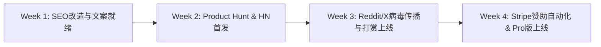

# OneHTML 全球增长与商业化落地白皮书 (Growth & Monetization Playbook)

> **定位口号**：*One HTML, Infinite Worlds. The itch.io & Shadertoy for the Generative AI Era.*  
> **核心使命**：为由 Claude Artifacts、OpenAI Codex/GPT、v0、Cursor 等生成式 AI 编写的单文件 HTML5 原生作品（3D 模拟器、独立游戏、视觉艺术、实用工具）提供零信任双沙箱运行环境、不可篡改版本归档以及全球创作者发现网络。

---

## 一、OneHTML 冷启动全球引爆方案 (Cold Start Go-To-Market)

### 1. 目标受众与心智触点 (Audience & Value Hooks)

| 受众群体 | 核心痛点 | OneHTML 核心抓手 (Hook) |
| :--- | :--- | :--- |
| **AI 独立创作者 (Claude/GPT 玩家)** | 在 Claude Artifacts 或 ChatGPT 里跑出惊艳 3D 游戏，但分享链接易失效、缺少版本管理、社交传播受限 | **“一键托管、永久版本快照 (SHA-256)、带安全沙箱的公开可玩链接”** |
| **独立游戏开发者 & 三方美术** | itch.io 发布门槛重（打包、配置环境），自建网站部署复杂且存在 iframe 跨域安全风险 | **“零构建流程 (No Build Step)，单文件即发布，秒级分享与嵌入”** |
| **前端工程师 / WebGL 极客** | 追求单文件极致压缩（js13kGames 风格），缺乏专注于纯 HTML5 奇观的代码展示台 | **“零外部污染的双源安全沙箱 (`SANDBOX_ORIGIN`) + 查看源码与版本对比”** |

---

### 2. 六大核心社区发布与文案模版 (Community Launch Kit)

#### A. Hacker News: Show HN
- **发布时机**：美东时间周二或周三上午 8:00 AM EST (北京时间 21:00)，技术圈浏览高峰期。
- **发布姿态**：极度务实、强调架构设计与安全性（沙箱隔离与 Content-Addressable Storage），严禁浮夸营销用词。
- **标题候选**：
  - *Show HN: OneHTML – Sandboxed hosting for single-file AI-generated HTML5 games & 3D apps*
  - *Show HN: OneHTML – A zero-trust player for standalone HTML creations (Claude/GPT/Three.js)*
- **正文文案模版**：
```markdown
Hey HN,

I built OneHTML (https://onehtml.dev / open source at https://github.com/thelifeofgame/one-html) because I was fascinated by the explosion of standalone, single-file HTML5 games and WebGL demos being generated by Claude Artifacts, OpenAI Codex, and Cursor.

The problem: You get a mind-blowing 1.4MB standalone HTML file (like Felix Rieseberg's rain-soaked FPS 'Saltline' or OpenAI's real-time ocean simulator), but sharing it safely is hard. Running untrusted client-side HTML/JS in an iframe often risks cookie theft, session fixation, and XSS if not isolated properly.

We engineered OneHTML around three technical pillars:
1. Dual-Origin Zero-Trust Sandbox: Auth and metadata live on the main origin (`SITE_ORIGIN`), while games run strictly on an isolated `SANDBOX_ORIGIN`. Execution requires cryptographically signed, short-lived Play Tickets (HMAC SHA-256).
2. Immutable Content-Addressable Versions: Works are stored with SHA-256 checksums, enabling zero-drift historical snapshots and safe community adaptations.
3. Edge-First Architecture: Built on Cloudflare Workers + D1 + R2 (with local SQLite fallback for dev), rendering in under 50ms worldwide.

Our initial collection includes 6 curated standalone demos (including Felix's Saltline FPS, Ayi1337's Mosswing, and OpenAI's official GPT-5.2 WebGL demos).

The project is fully open source. Would love your feedback on our sandbox security model, performance, and where standalone HTML computing is heading!
```

---

#### B. Product Hunt 启动策略 (Launchpad)
- **目标**：进入当日 Top 3 Product of the Day，获取持久反向链接与海外早期科技尝鲜者。
- **产品标语 (Tagline)**：*The sandbox platform for single-file AI creations & HTML5 games*
- **分类标签**：`Developer Tools`, `Artificial Intelligence`, `Open Source`, `Games`
- **Maker Comment 模版**：
```markdown
Hello Product Hunt! 👋

With modern LLMs (Claude 3.5 Sonnet, GPT-5+, Cursor), creating an entire 3D game or interactive simulation in a *single HTML file* has become effortless. But sharing, running, and preserving them is still painful.

We created **OneHTML** to be the definitive home for standalone web artifacts.

✨ Highlights:
- 🕹️ Play Instantly: Run complex Three.js games, WebGL simulators, and canvas tools in one click.
- 🛡️ Zero-Trust Dual Sandbox: Cryptographically signed playback ensures unsafe user scripts never touch user cookies or site origins.
- 📦 Version Time-Machine: Content-addressable SHA-256 versions so your generative art never breaks.
- 🌍 Global Edge Delivery: Instant cold-loads powered by Cloudflare Workers.

Check out our curated launches—from full FPS shooters to celestial physics simulators—and share your own AI-coded creations today. Let us know what you think! 🚀
```

---

#### C. Reddit 矩阵投放规划 (Value-First Tactics)
> **原则**：绝不在正文直接硬推广，必须以“开源经验分享”、“代码解析”或“高燃 Demo 视频”开头，在评论区提供在线试玩。

1. **r/ClaudeAI**
   - **帖文标题**：*I collected the most insane single-file 3D games generated by Claude & built a zero-trust sandbox to run them safely*
   - **内容重点**：突出 `Saltline · Jimao`（Felix Rieseberg 的 1.4MB 雨夜港口 FPS）在 Claude 中的生成过程，探讨 Claude 在编写 WebGL/Three.js 复杂着色器上的极限，并附带 OneHTML 在线试玩免下载链接。
2. **r/webdev**
   - **帖文标题**：*How we built a dual-origin sandbox architecture to securely execute arbitrary user-submitted HTML5 games*
   - **内容重点**：架构剖析！解释主站与 `SANDBOX_ORIGIN` 隔离、Play Ticket 鉴权机制、CSP 严格策略、如何防止 ServiceWorker 投毒与 Storage 泄露。
3. **r/indiehackers**
   - **帖文标题**：*Building an itch.io for the Claude/Cursor era: From side project to Cloudflare edge deployment*
   - **内容重点**：分享轻量化产品出海、Edge SQLite + R2 的极致低成本运维方案（每月几美元支撑数十万次加载）。

---

#### D. X / Twitter 传播链条 (Viral Loop)
- **内容形式**：15秒 1080p 60fps 录屏视频（如 `Saltline` 的雨夜反射、`Ocean Wave` 的光影水波）+ 轮播展示。
- **Tweet Thread 结构**：
  - **1/5 爆款视频**：“You won't believe this entire 3D cyber-harbor FPS fits into a SINGLE 1.4MB HTML file without any external npm packages or build step. Powered by Claude + OneHTML. [Video]”
  - **2/5 痛点直击**：“Generative AI made creating standalone web experiences trivial. But where do you host them securely without setting up Vercel, buying domains, or getting hacked via unsanitized iframe embeds?”
  - **3/5 解决方案**：“We built @OneHTML: a dual-origin zero-trust sandbox player with SHA-256 immutable versions. Think of it as Shadertoy meets itch.io for the LLM age.”
  - **4/5 点名致敬**：“Shoutout to the brilliant creators in our initial showcase: @felixrieseberg (Saltline), @petergpt (London Railway), Ayi1337 (Mosswing), and the OpenAI team demos.”
  - **5/5 Call to Action**：“Try playing them directly in your browser (no install needed): https://onehtml.dev — What should we add to the collection next?”

---

## 二、作品元数据、长尾 SEO 与站点架构升级

### 1. 现有作品核心元数据深度提炼 (Collections Asset Mapping)

当前 `collections/catalog.json` 拥有的 6+ 个高质量示例是冷启动的核心流量密码：

| 作品 ID | 作品名称 | 创作者 & 来源 | 核心 SEO 关键词标签 |
| :--- | :--- | :--- | :--- |
| `saltline` | Saltline · Jimao (几猫 3A) | Felix Rieseberg · Claude | `claude 3d fps game`, `single file html game`, `webgl harbor shooter`, `claude artifacts game` |
| `mosswing` | Mosswing (林间飞行) | Ayi1337 · GPT-6 Astra | `procedural 3d flight simulator`, `one shot ai game`, `mobile friendly html5 3d game` |
| `london-railway`| London Dream Railway (伦敦梦幻铁路) | Peter Gostev · Codex | `openai codex 3d demo`, `threejs miniature london`, `procedural toy train browser game` |
| `openai-ocean` | Ocean Wave Simulation (海浪模拟) | OpenAI · GPT-5.2 | `gpt-5.2 webgl demo`, `real-time ocean wave simulation html`, `single-file fluid shader` |
| `openai-solar` | Solar System Explorer (太阳系漫游) | OpenAI · GPT-5.2 | `interactive solar system html`, `threejs planetary orbits`, `single file educational webgl` |
| `openai-asteroids`| Nebula Drifter (星云突围) | OpenAI · GPT-5.2 | `space dogfight html5 game`, `canvas glow particles arcade`, `standalone retro shooter` |
| `openai-lights` | Festival Lights Show (音乐灯光秀) | OpenAI · GPT-5 | `audio reactive led matrix html`, `web audio visualizer single file`, `canvas music light show` |

---

### 2. 动态 SEO 与爬虫友好架构改造 (SEO Architecture Action Plan)

当前主站为纯客户端 SPA（Client-side Rendering），搜索引擎爬虫（Googlebot、Bingbot、Twitterbot）在抓取时无法有效读取作品的动态详情。需要落地以下三项技术优化：

#### A. 边缘动态 SSR 元数据注入 (Edge Meta Injection in Cloudflare Worker)
在 `src/worker.js` 的 HTTP 路由处理中，识别 `/w/:id` 或 `/works/:id` 请求，直接在边缘提取作品元数据并注入到 HTML `<head>`：
```html
<!-- 动态注入示例 (for Google / Twitter Card / OpenGraph) -->
<title>Saltline · Jimao — Single-File FPS Game | OneHTML</title>
<meta name="description" content="A rain-soaked harbor FPS in about 1.4 MB. Fight robotic patrols and extract. Created with Claude Artifacts." />
<meta property="og:type" content="website" />
<meta property="og:title" content="Saltline · Jimao — 1.4MB Standalone FPS" />
<meta property="og:description" content="Play this single-file AI game directly in your browser on OneHTML." />
<meta property="og:image" content="https://onehtml.dev/covers/saltline.png" />
<meta property="og:url" content="https://onehtml.dev/w/saltline" />
<meta name="twitter:card" content="summary_large_image" />

<!-- 结构化数据 Schema.org JSON-LD -->
<script type="application/ld+json">
{
  "@context": "https://schema.org",
  "@type": "SoftwareApplication",
  "name": "Saltline · Jimao",
  "operatingSystem": "Any",
  "applicationCategory": "GameApplication",
  "offers": {
    "@type": "Offer",
    "price": "0",
    "priceCurrency": "USD"
  },
  "author": {
    "@type": "Person",
    "name": "Felix Rieseberg"
  }
}
</script>
```

#### B. 动态 `/sitemap.xml` 与 `/robots.txt`
在 Worker 路由中新增原生支持：
- `/sitemap.xml`：读取数据库内 `status='published'` 的所有作品，按 `<loc>https://onehtml.dev/w/{id}</loc>` 与 `<lastmod>{updated_at}</lastmod>` 输出标准 XML。
- `/robots.txt`：配置 `Allow: /`，针对 `/play/` 沙箱单次凭证路径配置 `Disallow: /play/*`（避免爬虫空耗签名凭据）。

#### C. 长尾词页面矩阵 (Category & Tag Landing Pages)
建立专属聚合子路径，瞄准海外搜索量正在井喷的生成式前端词群：
- `/tag/claude-artifacts` -> “Best Claude Artifacts Games & Demos”
- `/tag/openai-showcase` -> “OpenAI Standalone WebGL Demos”
- `/category/games` -> “Single-File HTML5 Games (No Download)”
- `/category/visual` -> “3D Procedural WebGL & Shader Experiments”

---

## 三、商业化闭环与分阶段变现规划 (Monetization Roadmap)

### 阶段一：MVP 阶段（即刻验证 · 轻量现金流）

#### 1. 赞助聚光灯席位 (Sponsored Spotlight Slots)
- **现状**：代码中已有 `openSponsor()` 模版（7天赞助，起拍 $5/周），但目前只记录至数据库后台待联系。
- **商业化升级**：
  - **定价**：基础位 **$9.99 / 7天**；首页首屏置顶位 **$29.99 / 7天**。
  - **接入方式**：在管理后台审核通过后，自动向申请者邮箱发送 Stripe Checkout 支付链接；支付成功 Webhook 自动点亮作品的 `sponsored_until` 字段。
  - **合规与口碑**：保留明显的 `Sponsored / 赞助展示` 标签，绝不伪造或影响自然点赞（Likes）排行榜。

#### 2. 创作者打赏与微激励 (Creator Tipping)
- **落地形态**：在全屏播放器顶部/底部工具栏中，增加 `Buy Me a Coffee` / `Stripe Tip` 按钮。
- **分润模式**：
  - 创作者可直接绑定个人 Stripe 或 Ko-fi 链接（前期 100% 归创作者，平台 0 抽成以吸引优质 AI 极客入驻）。
  - 为 OneHTML 自身设立 “Sponsor OneHTML Platform” 赞助入口。

---

### 阶段二：Pro 创作者订阅与高级托管 (Pro Hosting & Custom Domains)

针对高频使用 Claude/Cursor 的资深独立开发者与数码游民，推出 **OneHTML Pro** 会员（**$8 / 月** 或 **$69 / 年**）：

| 功能权益 | 免费版 (Free) | OneHTML Pro 会员 |
| :--- | :--- | :--- |
| **单文件容量上限** | 2.5 MB | **15 MB** (支持嵌入高清 4K 贴图、高保真音频) |
| **独立自定义域名** | 不支持 (onehtml.dev/w/name) | **支持** (绑定自定义域名，例如 `game.creator.com`) |
| **品牌水印与嵌入** | 带有 OneHTML 顶栏与外链 | **纯净无水印嵌入 (Unbranded iframe)**，支持嵌入创作者官网 |
| **版本回滚与私密分支** | 公开历史版本 | **私有作品保护 (Private Works & Drafts)**，邀请制体验 |
| **数据分析看板** | 基础游玩与点赞数 | **深度访客来源 (Referrers)、停留时长、国家分布** |

---

### 阶段三：B端赞助与生态联动 (Ecosystem & Partnerships)

1. **AI 编程工具赞助商席位 (Official AI Tool Sponsors)**：
   - 首页显著赞助位定向招商：面向 Cursor、v0.dev、Lovable、Replit、Bolt.new 等 AI Code 平台。
   - 展示形式：“Crafted with Claude / Deployed on OneHTML” 或 “Build your next single-file demo using [Partner Tool]”。
2. **企业级 / 团队内网 Artifact Hub (OneHTML Team)**：
   - 为设计团队、AI 原型验证团队提供私有化云端沙箱，集中测试由 AI 生成的产品前端原型，提供访问权限与加密防护。

---

## 四、执行排期与关键指征 (OKRs & Timeline)



### 关键目标 (Milestone Metrics - 首月)：
1. **PV / UV**：首发当周全网独立 UV 突破 **25,000+**，作品累计试玩次数（Play Count）突破 **100,000+**。
2. **社区收录**：吸引海外社区创作者自主投稿收录优质单文件作品 **50+ 个**。
3. **商业化验证**：
   - 第一期赞助展示位（Spotlight）售出 **4~6 个席位**（首月营收 ~$150-$200）。
   - 验证至少 10 位高频创作者对 Pro Custom Domain 的付费意向。

---
*文件已归档至：`/home/ubuntu/one-html/onehtml/docs/GROWTH_AND_MONETIZATION_PLAYBOOK.md`*
